# second-brain

**Save UI inspiration from any app. A vision model curates it into a private wiki
and turns your taste into a DESIGN.md your coding agent builds from.**

<p align="center">
  
</p>

- **Save from anywhere.** Share a post from X, Instagram or LinkedIn, any web page,
  a screenshot or a photo, from your phone or your computer.
- **Curated, not dumped.** A vision model reads the frames, measures the palette
  from pixels and files each capture under a topic: design, features, tools or
  practices. Code counts your recurring choices into a taste profile.
- **Your DESIGN.md.** The taste, or any saved style, becomes a
  [DESIGN.md](https://github.com/google-labs-code/design.md): tokens derived by
  code, contrast-checked, lint-clean. getdesign.md gives you Stripe's DESIGN.md;
  second-brain gives you yours.

This repository is the engine. Your wiki lives in a separate private repository.
What sets it apart and where it's going: [PRODUCT.md](PRODUCT.md) ·
[ROADMAP.md](ROADMAP.md).

## What you get

All of it lives in your private wiki repository, written by the worker and read
by your agent.

| Output | What it is |
|---|---|
| [The wiki](docs/wiki.md) | One page per topic, one source note per capture (with up to four frames of what it looked like) and an index, kept tidy by a weekly lint pass |
| [`taste.md`](docs/outputs.md#taste-profile) | Your recurring choices across captures, as a default look and motion |
| [`DESIGN.md`](docs/outputs.md#designmd) | The taste as design tokens, with a dark (or light) twin when your captures split; any style topic gets its own |
| [`AGENTS.md`](docs/outputs.md#agentsmd) | The ideas of your `practices` topics as rules a coding agent follows |
| [`stack.md`](docs/outputs.md#stackmd) | The tools you saved, by job: used, to try or stale |
| [`usage.md`](docs/outputs.md#usage-log) | What was built from which captures, so what proves useful stands out |

## Quick start

You need a GitHub account with [gh](https://cli.github.com) logged in and an API
key for the model: a free [Ollama](https://ollama.com) key by default, or
OpenAI, Anthropic, Gemini or OpenRouter. Capture from an iPhone or Mac with
Shortcuts, an Android phone or any computer with a browser.

1. Get the engine:

   ```bash
   git clone https://github.com/albegosu/second-brain ~/Developer/second-brain
   cd ~/Developer/second-brain
   ```

2. Set everything up. It asks for the model provider and its key, creates your
   private wiki repository and a private inbox repository next to it, and wires
   them together:

   ```bash
   bin/setup
   ```

   It stops once to let you create a capture token on GitHub (a page it opens
   for you: select only the inbox repository, Contents: Read and write).
3. Connect your devices with what it prints: on an iPhone or Mac, open
   `shortcut/Save to second-brain (GitHub inbox).shortcut` and answer its two
   questions; on Android or a computer, scan the QR code (or open the link) and
   install the [capture page](docs/capture.md#android-and-desktop).
4. Optionally, subscribe to the printed topic in the [ntfy](https://ntfy.sh) app
   to get a push when each capture is filed.
5. Share a post or a page. A few minutes later it's in your wiki, and Claude
   reads it through the `second-brain` skill.

That's all. The [docs](#docs) explain the pieces, how to set them up by hand,
and how to run the worker on your own computer instead.

## Capture from

- **iPhone or Mac:** [the Shortcut](docs/capture.md#the-shortcut), from any
  app's share sheet.
- **Android and any desktop browser:** [the capture page](docs/capture.md#android-and-desktop),
  [albegosu.github.io/second-brain](https://albegosu.github.io/second-brain/).
  Installed as an app on Android, it shows up in every share sheet; on a
  desktop, paste a link or drop an image.
- **[The command line](docs/capture.md#command-line):** `python -m worker.run --url <link>`
  or `--image <file>`, with an optional `--note`, without the inbox.

X, Instagram, LinkedIn, GitHub repositories, YouTube and every site yt-dlp
supports, any other page, images and the speech in videos:
[what it understands](docs/capture.md#what-it-understands).

## Use it from your agent

Claude reads the wiki through the `second-brain` skill before it designs or
builds something, and logs what it used. Link it where Claude reads skills
(`bin/setup` offers to):

```bash
ln -s ~/Developer/second-brain/skill/second-brain ~/.claude/skills/second-brain
```

Clients that don't load skills (Claude Desktop, Cursor, Windsurf, Zed…) can read
it over MCP with `bin/second-brain-mcp`, a
[read-only server on stdio](docs/integrations.md#other-agents-mcp).

## Run it your way

- **[GitHub Actions](docs/self-hosting.md#worker-on-github-actions-recommended)
  (the default):** the worker doesn't depend on any computer. `bin/setup` sets
  it up; a private fork of the engine needs a deploy key.
- **[All on your Mac](docs/self-hosting.md#all-on-this-mac-no-actions):** inbox
  and worker together, reachable from the iPhone on the same Wi-Fi, started with
  `bin/second-brain`.
- **[Supabase inbox](docs/self-hosting.md#supabase-inbox):** a free Supabase
  project queues captures instead of the inbox repository
  (`bin/setup --inbox supabase`).

Running the worker on your own computer (all on your Mac, or the command line)
needs a [local install](docs/self-hosting.md#install-the-worker-locally).
Phone notifications go through [ntfy](docs/integrations.md#phone-notifications),
and **Idea to grow** captures can plant your note in
[hypar](docs/integrations.md#hypar).

## Known limits

- **The wiki is written by a model.** It can over-generalize, so every claim on
  a page points to a source note that keeps what was extracted verbatim.
- **Timing can't be measured from still frames.** Durations are omitted on
  purpose.
- **Instagram and LinkedIn use your browser cookies,** against both platforms'
  terms. Use it only for yourself.
- **Instagram from GitHub Actions** fails more often for reels.
- **Page screenshots show the first screen only,** cookie banner included.
- **The inbox doesn't validate URLs beyond their scheme.**

The full text: [Known limits](docs/reference.md#known-limits).

## Docs

| File | What it covers |
|---|---|
| [docs/capture.md](docs/capture.md) | What it understands, the two inboxes, the Shortcut (and building it by hand), the capture page, the command line |
| [docs/wiki.md](docs/wiki.md) | Layout, categories, source notes, topic pages, re-analysis, the weekly lint pass |
| [docs/outputs.md](docs/outputs.md) | The taste profile, DESIGN.md, AGENTS.md, stack.md and the usage log |
| [docs/self-hosting.md](docs/self-hosting.md) | How the pieces fit, the manual Actions setup, all on this Mac, the Supabase inbox, the local install |
| [docs/integrations.md](docs/integrations.md) | MCP for other agents, hypar, phone notifications |
| [docs/reference.md](docs/reference.md) | Every setting, and the full known limits |
| [docs/taxonomy.md](docs/taxonomy.md) | The closed facet vocabulary the model picks from |
| [PRODUCT.md](PRODUCT.md) | What it is, who it's for and what sets it apart |
| [ROADMAP.md](ROADMAP.md) | What's planned and what's done |

## Contributing

Issues and pull requests are welcome: read [CONTRIBUTING.md](CONTRIBUTING.md)
first, and report vulnerabilities privately as [SECURITY.md](SECURITY.md)
explains. Everyone taking part follows the [Code of Conduct](CODE_OF_CONDUCT.md).

## License

[MIT](LICENSE). What you capture still belongs to its authors: keep your wiki
repository private.
